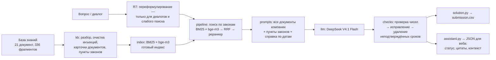

# Юридический ассистент ПСБ — Hack&Change 2026

RAG-ассистент для юристов банка. Отвечает на вопросы по договорам, внутренним документам компании и законам из базы знаний кейса:

- отвечает строго на заданный вопрос и ссылается на конкретный документ и пункт;
- применяет редакцию документа, действовавшую на дату события;
- поправляет ошибочные предпосылки вопроса, а не подстраивается под них;
- прямо говорит, когда данных в базе нет или их не хватает;
- понимает диалоги и бытовые формулировки («главбуха на испыталку на сколько можно взять?»);
- не поддаётся на инъекции в документах и вопросах.

В репозитории — ядро ассистента (плоские модули в корне), которое работает в двух режимах: пакетный прогон для автоматической проверки на платформе (`solution.py` → `submission.csv`) и фасад для веб-интерфейса (`assistant.py`). Оба режима отвечают одним и тем же конвейером.

## Результаты

| Версия | Балл (public) | Что произошло |
|---|---|---|
| v1, v1.2 | 20,77 | Модель не ответила ни на один вопрос: в файле только запасные цитаты. Совпадение баллов до сотых и привело к причине |
| v1.3 | 24,65 | Модель отвечает («не сдаваться»: ожидание прокси, повторные проходы) |
| v1.4: модули, готовый индекс, устойчивость B5–B8 | 13,65–28,9 | Ответы как у v1.3; разброс — шум платформы (днём выше, вечером ниже) |
| **v1.4 + B9 «строго на вопрос»** | **43,8 · 43,3 · 38,76** | +18 к контролю, отправленному подряд. Три значения — одни и те же запросы к модели в разных сабмитах |
| v1.4 + B9 + R7 «переформулирование запроса» | 39,5 | В пределах шума платформы; локально исправляет ложные отказы на бытовых формулировках |

**Главное на сейчас**

- **Лучший результат дала B9** — ответ строго на вопрос: судья (та же модель) считает «выдумкой» и верные детали, которых нет в эталоне. Подробно — [журнал сабмитов](docs/04_experiments.md).
- **Шум платформы — около 5 баллов** даже у одинаковых запросов, отправленных подряд ([что известно о платформе](docs/platform_facts.md)). Эффекты меньше этого по лидерборду не видны: решения принимаются по локальному парному замеру, а затем — по golden set.
- **Надёжность решена:** модель отвечает на все вопросы, при сбоях прокси и нехватке времени решение понижает уровень обработки, а не сдаётся (B5–B8 проверены в виртуальном времени).
- **Поиск — не узкое место:** на демо нужные документы и пункты в контексте в 51 из 51 ответа; почти все ошибки — генерации (лишнее, неполнота).
- **Golden set составляют продакты** по [инструкции](docs/golden_guide.md). До него — временный стенд на 18 демо-вопросах и целевые сценарии; несколько доработок ждут проверки на golden set ([чек-лист](eval/experiments.md)).

## Как устроено ядро



Ключевые решения:

- **Все 8 документов компании — в каждом запросе целиком** (~16 тыс. символов). Ловушки кейса строятся на связях между ними: две редакции регламента, договор и доп. соглашение, письмо комплаенса. Неизменное начало запроса кэшируется провайдером; всё переменное — после него.
- **Законы режутся по структуре** (статья → пункт → подпункт; у продолжений — вводная фраза пункта) и ищутся гибридно: BM25 и bge-m3 → RRF → реранкер. Короткие статьи идут целиком, у больших — найденные пункты и короткие «общие» пункты. Пометки Гаранта о редакциях остаются при пункте.
- **Ответ строго на вопрос (B9):** прямой ответ → документ и пункт → оговорка, только если без неё ответ неверен; 20–60 слов, без того, о чём не спрашивали.
- **Переформулирование запроса (R7):** для диалогов и вопросов, которые поиск «не узнал», — короткий вызов модели без документов: вопрос своими словами и поисковые запросы.
- **Даты и редакции сопоставляет код.** Модель получает готовую справку, какие документы действовали на дату из вопроса.
- **Каждое число в ответе сверяется с документами.** Неподтверждённые сроки и даты исправляются или удаляются: выдуманный факт обнуляет балл за вопрос.
- **Решение не падает и не сдаётся.** Полный `submission.csv` с запасными ответами пишется в первую секунду; дальше — ожидание модели, уровень обработки по прогнозу времени, мягкая реакция на сбои прокси, финальный проход на полном уровне.

### Модули (все в корне, зависимости сверху вниз)

| Модуль | Что внутри |
|---|---|
| `config.py` | Настройки из окружения, константы, флаги доработок, дедлайн, режим `batch` / `web`, журнал |
| `textproc.py` | Русский стеммер Snowball, токенизация, синонимы запроса |
| `dates.py` | Даты и периоды из вопроса, справка о действии документов на дату |
| `kb.py` | Загрузка ZIP/папки, удаление встроенных инструкций, метаданные документов, разбор законов, `doc_id` и разметка пунктов, отсылки внутри законов |
| `runtime.py` | Флаги деградации, скользящее время вызовов, выбор уровня обработки по прогнозу, счётчики вызовов |
| `llm.py` | Клиент прокси: повторы, общий cooldown при 429, адаптивная параллельность; chat / embeddings / rerank с временным отключением реранкера |
| `index.py` | BM25, векторы (готовый индекс или расчёт), гибрид RRF, поиск по нескольким запросам |
| `prompts.py` | Системный промпт, few-shot, сборка запроса, промпты исправления и переформулирования |
| `checks.py` | Проверка чисел, дат и ссылок, очистка ответа |
| `pipeline.py` | Ответ на вопрос (`answer_one`): переформулирование, отбор законов и документов, генерация, проверки, деградация; запасной ответ; `Result` с цитатами и контекстом |
| `probe.py` | Ожидание модели, блоки `PLATFORM PROBE` / `RUN STATS` в stderr |
| `solution.py` | Пакетный прогон: `questions.csv` → `submission.csv`, повторные и финальный проходы |
| `assistant.py` | Фасад для веб-части (в сабмит не входит) |

## Внешние API

Все вызовы — к одному OpenAI-совместимому прокси. На платформе адрес, ключ и модели подставляет платформа; локально — из окружения или `.env` (шаблон — [`.env.example`](.env.example); `.env` в git не попадает).

| Сервис | Модель (по умолчанию) | Эндпоинт | Переменные |
|---|---|---|---|
| Генерация | DeepSeek V4.1 Flash | `POST {LLM_BASE_URL}/chat/completions` | `LLM_BASE_URL`, `LLM_API_KEY`, `LLM_MODEL` (или `OPENAI_*`, `GEN_MODEL`) |
| Эмбеддинги | `baai/bge-m3` | `POST {LLM_BASE_URL}/embeddings` | `EMB_MODEL`; ключ — `EMBEDDER_API_KEY` или `LLM_API_KEY` |
| Реранкер (необязателен) | `cohere/rerank-5-fast` | `POST {LLM_BASE_URL}/rerank` | `RERANKER_MODEL`; ключ — `RERANKER_API_KEY` или `LLM_API_KEY` |

Подключение ключа: `cp .env.example .env`, заполнить значения, экспортировать переменные (или передать их фасаду через `overrides`). Без эмбеддингов ядро работает на BM25, без реранкера — на гибридном поиске.

### Переменные окружения

| Переменная | По умолчанию | Назначение |
|---|---|---|
| `DATA_DIR` | `data` | Папка с `questions.csv` и `knowledge-base.zip` (или `knowledge-base/`) |
| `TEMPERATURE`, `MAX_TOKENS` | 0, 1024 | Параметры генерации (задаёт платформа) |
| `MAX_WORKERS` | 2 | Одновременных обращений к прокси |
| `TOP_K`, `RERANKER_TOP_N` | — | Число кандидатов поиска (30–40) и фрагментов законов в контексте (8–14) |
| `SOLUTION_TIME_BUDGET` | 990 | Бюджет пакетного прогона, с (платформа даёт 20 мин) |
| `SOLUTION_DEBUG` | — | `1` — `debug.jsonl` с контекстом, ранжированием и черновиками |
| `SOLUTION_PROBE` | `1` | `0` — не выводить блоки `PLATFORM PROBE` / `RUN STATS` |
| `SOLUTION_PROBE_RERANK` | — | `1` — пробный вызов `/rerank` в `PLATFORM PROBE` (только локально) |
| `SOLUTION_TODAY` | — | Зафиксировать текущую дату (`ГГГГ-ММ-ДД`) для тестов |
| `SOLUTION_MODE` | `batch` | `web` — режим фасада (ставит сам `assistant.py`) |

**Флаги доработок** — каждая отключается своим флагом независимо от остальных:

| Переменная | По умолчанию | Доработка |
|---|---|---|
| `SOLUTION_PREBUILT_INDEX` | `1` | 7.2: готовый индекс `index_vectors.json` (`SOLUTION_INDEX_FILE` — другой путь) |
| `SOLUTION_SOFT_DEGRADE` | `1` | B5: разовые 4xx не понижают уровень на весь прогон |
| `SOLUTION_RERANK_RECHECK` | `1` | B6: реранкер отключается временно |
| `SOLUTION_LEVEL_FORECAST` | `1` | B7: уровень обработки по прогнозу оставшегося времени |
| `SOLUTION_FINAL_PASS` | `1` | B8: остаток времени — на переответ на полном уровне |
| `SOLUTION_CONCISE` | `1` | B9: строго на вопрос, 20–60 слов (`0` — формат v1.3) |
| `SOLUTION_ANSWER_TEMPLATE` | `1` | B14: ответ в формате эталона «… Источник: <документ>, п. N.», после источника ничего; работает вместе с B9 (принято предварительно) |
| `SOLUTION_REWRITE` | `1` | R7: переформулирование для диалогов и слабого поиска (принято предварительно) |
| `SOLUTION_FEWSHOT` | `demo` | 7.6: `fictional` — few-shot на вымышленных документах (ждёт golden set) |
| `SOLUTION_FIX_DOCNUM` | — | B3: номера документов не проверяются как числа (ждёт golden set) |
| `SOLUTION_CHECK_REFS` | — | 7.1: проверка номеров пунктов и документов в ответе (ждёт golden set) |
| `SOLUTION_GENERAL_POINTS` | `1` | B12: общие пункты больших статей вне урезанного бюджета — ставка НДС в вопросах о договорах (принято предварительно) |
| `SOLUTION_DATE_CONDITIONS` | — | R4: условия доп. соглашений и редакции законов в справке по датам (отложено) |
| `SOLUTION_CROSS_REFS` | — | R6: пункты законов, на которые ссылаются найденные (бэклог) |

**Зависимости ядра:** Python 3.9+ и `httpx==0.28.1` (`requirements.txt`). Инструменты разработки — только стандартная библиотека; локальные эмбеддинги — через [ollama](https://ollama.com) (`ollama pull bge-m3`).

## Запуск

```bash
python3 -m venv .venv && .venv/bin/pip install -r requirements.txt

# пакетный прогон: DATA_DIR/questions.csv → submission.csv
cp data/demo_questions.csv data/questions.csv
DATA_DIR=data .venv/bin/python solution.py                      # без ключа — только запасные ответы
.venv/bin/python tools/ask.py --stub "Какая арендная плата?"     # фасад без сети (заглушка прокси)
.venv/bin/python tools/ask.py --dev "Какая арендная плата?"      # фасад через dev-прокси (ключ из .env)
```

`tools/ask.py` — вопрос или диалог (`--dialog реплика1 реплика2 …`) → JSON фасада; `--docs`, `--doc <doc_id>`, `--health`.

### Готовый индекс

`tools/build_index.py` заранее считает эмбеддинги фрагментов базы (локальная bge-m3 через dev-прокси или `--env` — эмбеддер из окружения) и пишет `index_vectors.json` в корень; `tools/make_submission.py` кладёт его в архив. Ядро берёт его на старте, если совпали отпечаток базы, нарезка, модель и размерность, а 8 контрольных векторов API совпадают с сохранёнными (косинус ≥ 0,99); иначе — расчёт при запуске. Любая ошибка загрузки не роняет прогон. Старт эмбеддингов: 27,9 с → 2,6 с.

## Тесты

```bash
tools/run_tests.sh            # всё без сети: на модулях в корне и на эталоне v1.3
tools/run_tests.sh root
```

112 тестов на каждой цели:

- **Фиксация поведения v1.3:** снимок детерминированных частей на реальной базе и golden master — 18 демо-вопросов через `main()` с заглушкой прокси в 7 сценариях (обычный, выдуманные числа, отказы 4xx, 429 и тайм-ауты, без эмбеддингов). С выключенными флагами тексты всех сообщений в модель и ответы совпадают с v1.3 байт в байт. Эталоны — `tests/fixtures/`, копия v1.3 — `tools/baseline/solution_v1_3.py`.
- **Доработки за флагами** (`tests/test_pending.py`): что каждый флаг делает задуманное и не ломает прогон; устойчивость B5–B8 — в виртуальном времени (`tests/simclock.py`).
- **HTTP-слой:** повторы, 429, 4xx, разбор ответов (`httpx.MockTransport`).
- **Контракт фасада:** JSON-схема, стабильность `doc_id`, смещения цитат и контекста, ответ фасада = пакетный режим, отсутствие исключений наружу.
- **Готовый индекс:** загрузка, чужой и битый файл.
- Перед коммитом: `python tools/check_core.py` — импорты ядра (только stdlib и httpx), неопределённые имена, порядок зависимостей.

## Сабмит на платформу

```bash
.venv/bin/python tools/make_submission.py                                   # dist/psb_submission_<commit>.zip + проверка
.venv/bin/python tools/make_submission.py --stub-proxy                      # проверка с прогоном через заглушку прокси
.venv/bin/python tools/make_submission.py --stub-proxy --flag SOLUTION_X=1  # значение флага по умолчанию — только в архиве
```

В архив попадают только модули, которые импортирует `solution.py`, `requirements.txt` и `index_*.json` — все в корне архива. Проверка: распаковка во временную папку, чистый venv только с зависимостями из `requirements.txt`, запуск на демо-вопросах, проверка формата `submission.csv` и состава архива. Платформа логов не показывает — только балл и длительность. Какие архивы отправлялись и с каким баллом — в [журнале сабмитов](docs/04_experiments.md) и в описаниях коммитов (раздел «Архивы»).

## Оценка качества

- **Golden set** (`eval/golden.csv`) составляют продакты по [инструкции](docs/golden_guide.md) и [шаблону](eval/golden_template.csv); проверка набора — `python3 tools/check_golden.py eval/golden.csv`.
- **Стенд** (`tools/eval.py`): прогон текущей версии, v1.3 и стартового примера организаторов; локальный LLM-судья по регламенту (два порядка A/B, «выдуманный факт = 0», итог 0,7 × Match + 0,3 × Win; варианты судьи j2 — мягкий и j1 — строгий); оценка по эталонам задания и организаторов (`--set smoke_org`, `judge --tag _org`). Все вызовы — через `tools/dev_proxy.py` (провайдер из `.env`, локальная bge-m3, кэши); на платформе не используется. При сбое провайдера прогон и оценка не сохраняются.
- **Временный стенд** до golden set ([stand.md](eval/stand.md)): 18 демо-вопросов, основная метрика — 10 вопросов вне few-shot; замер **парный** — прогоны без флага и с флагом чередуются в одной сессии (провайдер дрейфует во времени); целевые сценарии для каждой доработки — `eval/scenarios/` (проверка механизма, в golden set не переносятся).
- **Нарезка базы:** `tools/show_chunks.py "<документ>"` (`--full` — полный и поисковый текст, `--list` — все документы); служебная папка [eval/chunks/](eval/chunks/README.md) — нарезка всех документов и законов, пересоздаётся `--dump eval/chunks` (тест сверяет её с `kb.py`).
- **Анализ:** `tools/round2_compare.py` (сравнение задачи с калибровкой или парное), `tools/diagnose.py` (ошибки поиска против генерации, лишнее, «Да/Нет»), `tools/answer_audit.py` (детали сверх эталона), `tools/fault_eval.py` (сбои и нагрузка в виртуальном времени, без токенов).
- **Протокол:** одна доработка — за флагом — гипотеза до запуска — замер — решение ([журнал](eval/experiments.md), [бэклог](eval/backlog.md)); коммиты — по правилу 2 из «Правил работы команды». Учёт токенов — `eval/token_ledger.csv`, `python tools/eval.py tokens`.

```bash
.venv/bin/python tools/eval.py --set smoke run --target current --label smoke_x --stage dev --judge
SOLUTION_X=1 .venv/bin/python tools/eval.py --set eval/scenarios/X_agent.csv run --target current --label x_on --stage dev
.venv/bin/python tools/round2_compare.py --task x_demo_on --base x_demo_off --org --scenarios eval/scenarios/X_agent.csv --sc-off x_off --sc-on x_on
```

## Интеграция с веб-интерфейсом

Ядро подключается через `assistant.LegalAssistant` — см. [docs/integration.md](docs/integration.md): методы, JSON-контракт (версия 1.1), статусы, цитаты со смещениями для подсветки, поле `context` (какие документы и фрагменты ушли в модель и почему), каталог и документы, время и память, потокобезопасность, рекомендации по отображению. Примеры — [docs/contract_examples/](docs/contract_examples/). С R7 уточняющие вопросы диалога отвечаются на один вызов модели дольше; отключить — `SOLUTION_REWRITE=0`.

## Веб-интерфейс и Docker

_Заполняет веб-разработчик._

## Известные ограничения

- **Только действующие редакции законов.** Для вопросов о периоде до изменения нормы ассистент говорит, что прежней редакции в базе нет.
- **Номера пунктов в ответе по умолчанию не проверяются** (проверяются числа и даты). Проверка ссылок (7.1), исправление B3 и вымышленные few-shot (7.6) реализованы за флагами и ждут замера на golden set — [чек-лист](eval/experiments.md).
- **Few-shot сейчас на демо-вопросах** (8 из 18): оценка на этих вопросах завышена, основная метрика — вопросы вне few-shot.
- **Модель недетерминирована** даже при `TEMPERATURE=0`: одни и те же запросы дают на платформе баллы от 38,8 до 43,8.
- **Реранкер** в разработке недоступен (у dev-провайдера нет `/rerank`); качество его порядка не измерено ([бэклог](eval/backlog.md), B17).
- **Статус и цитаты для веба** вычисляются правилами по тексту ответа; точность будет измерена на golden set.

## Структура репозитория

```
*.py                 ядро (модули выше) и фасад assistant.py
requirements.txt     httpx==0.28.1 — для сабмита и ядра
index_vectors.json   готовые эмбеддинги фрагментов базы (bge-m3)
data/                база знаний (zip и распакованная), демо-вопросы и эталоны организаторов
docs/                документация команды, integration.md, golden_guide.md, platform_facts.md, задания раундов
docs/organizers/     кейс, технические требования, README стартового примера
eval/                шаблон golden set, смоук-наборы, сценарии, черновики вопросов, журнал экспериментов,
                     бэклог, стенд, отчёты, прогоны, ответы стартового примера, учёт токенов
eval/chunks/         служебная: нарезка всех документов и законов на фрагменты (генерируется)
tests/               тесты и эталоны поведения
tools/               сборка сабмита, оценка и анализ, dev-прокси, заглушка прокси, ask.py, проверки
tools/baseline/      v1.3 и стартовый пример организаторов
dist/                собранные архивы сабмитов (в git не попадают)
```

## Документация

| Документ | О чём |
|---|---|
| [01 Задача и метрика](docs/01_task_and_metric.md) | Что проверяет судья, как считается балл, что известно о платформе |
| [02 База знаний и типы вопросов](docs/02_knowledge_base.md) | Состав базы, встроенные ловушки, типы вопросов и правильная реакция |
| [03 Архитектура v1.3](docs/03_architecture.md) | Поиск, контекст, промпт, проверки, уровни обработки, надёжность (исходная версия) |
| [04 Журнал сабмитов](docs/04_experiments.md) | Сабмиты, баллы, гипотезы и выводы |
| [05 План](docs/05_roadmap.md) | Что пробовать дальше; подходы RAG; требования финальной сдачи |
| [06 Тестирование](docs/06_testing.md) | Сценарии сбоев v1.3 (актуальный набор тестов — раздел «Тесты» выше) |
| [Интеграция](docs/integration.md) | Контракт ядра для веб-разработчика |
| [Golden set](docs/golden_guide.md) | Как составить набор для оценки |
| [Платформа](docs/platform_facts.md) | Что известно о платформе и шуме лидерборда |
| [Журнал экспериментов](eval/experiments.md), [бэклог](eval/backlog.md), [стенд](eval/stand.md) | Доработки по протоколу, замеры, идеи |
| [CHANGELOG](CHANGELOG.md) | Изменения по версиям |

## Правила работы команды

1. **Один сабмит — одно изменение поведения** (относительно предыдущего сабмита; к коммитам не относится). Иначе по баллу не понять, что сработало. В день 5 сабмитов, сброс в 00:00 МСК. Эффекты меньше ~5 баллов платформа не различает.
2. **Коммиты — по задаче, а не по каждой правке:** 1–2 коммита на задачу («код + тесты + документация» и «замер + отчёт + решение»); мелкие правки той же задачи — в её коммит, пока он не запушен. Сообщение — по-русски: заголовок, подробное описание (что изменено, меняются ли ответы, флаги, результаты замеров) и раздел «Архивы» — какие `dist/psb_submission_*.zip` собраны из коммита, номер сабмита, балл и длительность или «не отправлялся».
3. **До отправки** — строка в [журнале](docs/04_experiments.md#сабмиты): версия, изменение, гипотеза. **После** — балл и вывод.
4. **Перед сабмитом** — `tools/run_tests.sh` и `tools/make_submission.py`, всё должно пройти.
5. **Без подгонки под демо-вопросы.** Итог считается на private-вопросах.
6. **Никаких ключей в коде и истории git.** Только через переменные окружения.
7. **Репозиторий приватный:** в нём материалы организаторов. Для финальной сдачи нужно выдать доступ аккаунту жюри `hack-and-change-2026`.
