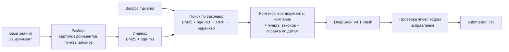

# Юридический ассистент ПСБ — Hack&Change 2026

RAG-ассистент для юристов банка. Отвечает на вопросы по договорам, внутренним документам компании и законам из базы знаний кейса:

- ссылается на конкретный документ и пункт;
- применяет редакцию документа, действовавшую на дату события;
- поправляет ошибочные предпосылки вопроса, а не подстраивается под них;
- прямо говорит, когда данных в базе нет или их не хватает;
- не поддаётся на инъекции в документах и вопросах.

Сейчас в репозитории — решение для автоматической проверки на платформе: `solution.py` + `requirements.txt`.

## Результаты

| Версия | Балл (public) | Что произошло |
|---|---|---|
| v1 | 20,77 | Модель не ответила ни на один вопрос: в файле только запасные цитаты |
| v1.2 | 20,77 | То же самое. Совпадение баллов до сотых и привело к причине |
| **v1.3** | **24,652** | Модель отвечает. **3-е место** в public-рейтинге (лидер — 27,97) |

**Главное на сейчас**

- **Надёжность решена.** Причина нулей найдена и исправлена: предохранитель сдавался, если прокси поднимался не сразу.
- **Узкое место — качество ответов.** Ответы модели дали всего +3,9 к одним цитатам.
- **Baseline судьи сильный.** Все команды ниже 0,3, хотя ответ «на уровне baseline» дал бы не меньше 0,35.
- **Реальных ответов модели мы ещё не видели.** Первый шаг дальше — прочитать их на демо-вопросах и сравнить с эталонами.

Подробно — в [журнале экспериментов](docs/04_experiments.md) и [плане](docs/05_roadmap.md).

## Как устроено



Ключевые решения:

- **Все 8 документов компании — в каждом запросе целиком** (~5 тыс. токенов). Ловушки кейса строятся на связях между ними: две редакции регламента, договор и допсоглашение, письмо комплаенса.
- **Законы режутся по структуре** (статья → пункт → подпункт) и ищутся гибридно. Пометки Гаранта о редакциях остаются при пункте.
- **Даты и редакции сопоставляет код.** Модель получает готовую справку, какие документы действовали на дату из вопроса.
- **Каждое число в ответе сверяется с документами.** Неподтверждённые сроки и даты исправляются или удаляются, потому что выдуманный факт обнуляет балл за вопрос.
- **Решение не падает и не сдаётся.** Полный `submission.csv` с запасными ответами пишется в первую секунду. Дальше решение ждёт модель, понижает режим при отказах прокси и повторяет неотвеченные вопросы до дедлайна.

## Файлы

```
solution.py        решение (v1.3), единая точка входа платформы
requirements.txt   httpx==0.28.1 — единственная зависимость
CHANGELOG.md       что менялось от версии к версии
docs/              документация (ниже)
```

Код отправленных архивов (`psb_submission_v1.zip`, `_v1_2.zip`, `_v1_3.zip`) хранится отдельно. `solution.py` здесь совпадает с `psb_submission_v1_3.zip`, кроме строки версии в заголовке файла.

## Отправка на платформу

```bash
zip -X psb_submission.zip solution.py requirements.txt
```

Оба файла — в корне архива. Базу знаний и вопросы класть в архив не нужно. Вложенные папки на платформу не переносятся.

## Локальный запуск

```bash
pip install httpx==0.28.1
mkdir -p data && cp /путь/к/knowledge-base.zip /путь/к/questions.csv data/

# без ключа — только запасные ответы (проверка, что всё читается и файл пишется)
DATA_DIR=data python3 solution.py

# с моделью — любой OpenAI-совместимый API, например DeepSeek
DATA_DIR=data LLM_BASE_URL=https://api.deepseek.com LLM_API_KEY=$DEEPSEEK_API_KEY \
  LLM_MODEL=deepseek-chat SOLUTION_DEBUG=1 python3 solution.py
```

Результат — `submission.csv`. С `SOLUTION_DEBUG=1` рядом появляется `debug.jsonl`: контекст, черновик и итог по каждому вопросу. Лог пишется в stderr. Все переменные окружения перечислены в [архитектуре](docs/03_architecture.md#переменные-окружения).

Набор проверок — заглушка прокси со сценариями сбоев, тесты поиска и проверки чисел, прогон на настоящей модели — поставляется отдельным архивом `psb_test_kit.zip` (см. [тестирование](docs/06_testing.md)).

## Документация

| Документ | О чём |
|---|---|
| [01 Задача и метрика](docs/01_task_and_metric.md) | Что проверяет судья, как считается балл, как читать наш балл, что известно о платформе |
| [02 База знаний и типы вопросов](docs/02_knowledge_base.md) | Состав базы, встроенные ловушки, типы вопросов и правильная реакция на каждый |
| [03 Архитектура](docs/03_architecture.md) | Как работает `solution.py`: поиск, контекст, промпт, проверки, уровни обработки, надёжность, карта кода |
| [04 Журнал экспериментов](docs/04_experiments.md) | Сабмиты, рейтинг, как нашли причину нулей, гипотезы со статусами, выводы, принятые решения |
| [05 План](docs/05_roadmap.md) | Что пробовать дальше и в каком порядке; подходы RAG — взятые и отклонённые; требования финальной сдачи |
| [06 Тестирование](docs/06_testing.md) | Локальные проверки, сценарии сбоев с результатами, прогон на настоящей модели |
| [CHANGELOG](CHANGELOG.md) | Изменения по версиям |

## Правила работы команды

1. **Один сабмит — одно изменение.** Иначе по баллу не понять, что сработало. В день 5 сабмитов, сброс в 00:00 МСК.
2. **До отправки** — строка в [журнале](docs/04_experiments.md#сабмиты): версия, изменение, гипотеза. **После** — балл и вывод.
3. **Перед сабмитом** — локальные проверки (`tools/run_all_tests.sh` из набора), все должны пройти.
4. **Без подгонки под демо-вопросы.** Итог считается на private-вопросах.
5. **Никаких ключей в коде и истории git.** Только через переменные окружения.
6. **Репозиторий приватный:** в нём материалы организаторов. Для финальной сдачи нужно выдать доступ аккаунту жюри `hack-and-change-2026`.
