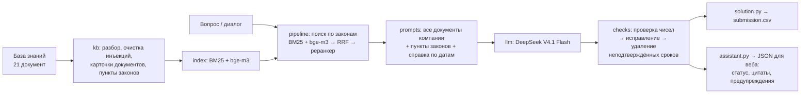

# Юридический ассистент ПСБ — Hack&Change 2026

RAG-ассистент для юристов банка. Отвечает на вопросы по договорам, внутренним документам компании и законам из базы знаний кейса:

- ссылается на конкретный документ и пункт;
- применяет редакцию документа, действовавшую на дату события;
- поправляет ошибочные предпосылки вопроса, а не подстраивается под них;
- прямо говорит, когда данных в базе нет или их не хватает;
- не поддаётся на инъекции в документах и вопросах.

В репозитории — ядро ассистента (плоские модули в корне), которое работает в двух режимах: пакетный прогон для автоматической проверки на платформе (`solution.py` → `submission.csv`) и фасад для веб-интерфейса (`assistant.py`). Оба режима отвечают одним и тем же конвейером.

## Результаты

| Версия | Балл (public) | Что произошло |
|---|---|---|
| v1 | 20,77 | Модель не ответила ни на один вопрос: в файле только запасные цитаты |
| v1.2 | 20,77 | То же самое. Совпадение баллов до сотых и привело к причине |
| v1.3 | 24,652 | Модель отвечает. 3-е место в public-рейтинге (лидер — 27,97) |
| **v1.4** | **28,9** | Ответы те же, что у v1.3: код разложен на модули, добавлены диагностика и фасад для веба. Разница с v1.3 — шум публичного лидерборда |

**Главное на сейчас**

- **Надёжность решена.** Модель отвечает на все вопросы; при сбоях прокси решение понижает режим, а не сдаётся.
- **Лидерборд шумный.** Одинаковые по ответам версии дали 24,65 и 28,9. Решения о доработках принимаем по локальной оценке на golden set, лидерборд — контроль ([что известно о платформе](docs/platform_facts.md)).
- **Узкое место — качество ответов.** Доработки идут по одной, за флагами и с замером ([журнал](eval/experiments.md), [бэклог](eval/backlog.md)).
- **Golden set составляют продакты** по [инструкции](docs/golden_guide.md); до него 18 демо-вопросов используются только для смоук-проверок.

Подробно — в [журнале сабмитов](docs/04_experiments.md) и [плане](docs/05_roadmap.md).

## Как устроено ядро



Ключевые решения:

- **Все 8 документов компании — в каждом запросе целиком** (~5 тыс. токенов). Ловушки кейса строятся на связях между ними: две редакции регламента, договор и допсоглашение, письмо комплаенса. Неизменное начало запроса хорошо кэшируется провайдером.
- **Законы режутся по структуре** (статья → пункт → подпункт) и ищутся гибридно. Пометки Гаранта о редакциях остаются при пункте.
- **Даты и редакции сопоставляет код.** Модель получает готовую справку, какие документы действовали на дату из вопроса.
- **Каждое число в ответе сверяется с документами.** Неподтверждённые сроки и даты исправляются или удаляются: выдуманный факт обнуляет балл за вопрос.
- **Решение не падает и не сдаётся.** Полный `submission.csv` с запасными ответами пишется в первую секунду; дальше — ожидание модели, понижение режима при отказах прокси, повторные проходы до дедлайна.

### Модули (все в корне, зависимости сверху вниз)

| Модуль | Что внутри |
|---|---|
| `config.py` | Настройки из окружения, константы, дедлайн, режим `batch` / `web`, журнал |
| `textproc.py` | Русский стеммер Snowball, токенизация, синонимы запроса |
| `dates.py` | Даты и периоды из вопроса, справка о действии документов на дату |
| `kb.py` | Загрузка ZIP/папки, удаление встроенных инструкций, метаданные документов, разбор законов, `doc_id` и разметка пунктов |
| `runtime.py` | Флаги деградации, скользящее время вызовов, выбор уровня обработки, счётчики вызовов |
| `llm.py` | Клиент прокси: повторы, общий cooldown при 429, адаптивная параллельность; chat / embeddings / rerank |
| `index.py` | BM25, dense-векторы, гибрид RRF |
| `prompts.py` | Системный промпт, few-shot, сборка запроса |
| `checks.py` | Проверка чисел и дат, очистка ответа |
| `pipeline.py` | Ответ на вопрос (`answer_one`), запасной ответ, структурированный `Result` |
| `probe.py` | Ожидание модели, блоки `PLATFORM PROBE` / `RUN STATS` в stderr |
| `solution.py` | Пакетный прогон: `questions.csv` → `submission.csv` |
| `assistant.py` | Фасад для веб-части (в сабмит не входит) |

## Внешние API

Все вызовы — к одному OpenAI-совместимому прокси. На платформе адрес и служебный ключ подставляет платформа; локально — из окружения или `.env` (шаблон — [`.env.example`](.env.example); `.env` в git не попадает).

| Сервис | Модель | Эндпоинт | Переменные |
|---|---|---|---|
| Генерация | DeepSeek V4.1 Flash | `POST {LLM_BASE_URL}/chat/completions` | `LLM_BASE_URL`, `LLM_API_KEY`, `LLM_MODEL` (или `OPENAI_*`, `GEN_MODEL`) |
| Эмбеддинги | BAAI/bge-m3 | `POST {LLM_BASE_URL}/embeddings` | `EMB_MODEL`; ключ — `EMBEDDER_API_KEY` или `LLM_API_KEY` |
| Реранкер (необязателен) | Qwen3 Reranker 8B | `POST {LLM_BASE_URL}/rerank` | `RERANKER_MODEL`; ключ — `RERANKER_API_KEY` или `LLM_API_KEY` |

Подключение ключа: `cp .env.example .env`, заполнить значения, экспортировать переменные (или передать их фасаду через `overrides`). Без эмбеддингов ядро работает на BM25, без реранкера — на гибридном поиске.

### Переменные окружения

| Переменная | По умолчанию | Назначение |
|---|---|---|
| `DATA_DIR` | `data` | Папка с `questions.csv` и `knowledge-base.zip` (или `knowledge-base/`) |
| `TEMPERATURE`, `MAX_TOKENS` | 0, 1024 | Параметры генерации (задаёт платформа) |
| `MAX_WORKERS` | 2 | Одновременных обращений к прокси |
| `TOP_K`, `RERANKER_TOP_N` | — | Влияют на число кандидатов поиска |
| `SOLUTION_TIME_BUDGET` | 990 | Бюджет пакетного прогона, с (платформа даёт 20 мин) |
| `SOLUTION_DEBUG` | — | `1` — `debug.jsonl` с контекстом и черновиками |
| `SOLUTION_PROBE` | `1` | `0` — не выводить блоки `PLATFORM PROBE` / `RUN STATS` |
| `SOLUTION_PROBE_RERANK` | — | `1` — пробный вызов `/rerank` в `PLATFORM PROBE` (только локально) |
| `SOLUTION_TODAY` | — | Зафиксировать текущую дату (`ГГГГ-ММ-ДД`) для тестов |
| `SOLUTION_FEWSHOT` | `demo` | `fictional` — few-shot на вымышленных документах (7.6, ждёт замера) |
| `SOLUTION_FIX_DOCNUM` | — | `1` — номера документов не проверяются как числа (B3, ждёт замера) |
| `SOLUTION_CHECK_REFS` | — | `1` — проверка номеров пунктов и документов в ответе (7.1, ждёт замера) |
| `SOLUTION_MODE` | `batch` | `web` — режим фасада (ставит сам `assistant.py`) |

**Зависимости ядра:** Python 3.9+ и `httpx==0.28.1` (`requirements.txt`). Инструменты разработки — только стандартная библиотека; локальные эмбеддинги — через [ollama](https://ollama.com) (`ollama pull bge-m3`).

## Запуск

```bash
python3 -m venv .venv && .venv/bin/pip install -r requirements.txt

# пакетный прогон: DATA_DIR/questions.csv → submission.csv
cp data/demo_questions.csv data/questions.csv
DATA_DIR=data .venv/bin/python solution.py                      # без ключа — только запасные ответы
.venv/bin/python tools/ask.py --stub "Какая арендная плата?"     # фасад без сети (заглушка прокси)
.venv/bin/python tools/ask.py --dev "Какая арендная плата?"      # фасад через dev-прокси (ключ из .env)
```

`tools/ask.py` — вопрос или диалог (`--dialog реплика1 реплика2 …`) → JSON фасада; `--docs`, `--doc <doc_id>`, `--health`.

### Готовый индекс

Сейчас эмбеддинги базы считаются при каждом запуске (до 60 с, затем — работа на BM25). Сборка готового индекса `index_*.json` в корне и его проверка на платформе — доработка 7.2 в [очереди](eval/experiments.md).

## Тесты

```bash
tools/run_tests.sh            # всё без сети: на модулях в корне и на эталоне v1.3
tools/run_tests.sh root
```

- **Фиксация поведения v1.3:** снимок детерминированных частей на реальной базе и golden master — 18 демо-вопросов через `main()` с заглушкой прокси в 7 сценариях (обычный, выдуманные числа, отказы 4xx, 429 и тайм-ауты, без эмбеддингов). Тексты всех сообщений в модель и ответы должны совпасть с v1.3 байт в байт. Эталоны — `tests/fixtures/`, копия v1.3 — `tools/baseline/solution_v1_3.py`.
- **HTTP-слой:** повторы, 429, 4xx, разбор ответов (`httpx.MockTransport`).
- **Контракт фасада:** JSON-схема, стабильность `doc_id`, смещения цитат, ответ фасада = пакетный режим, отсутствие исключений наружу.
- Перед коммитом: `python tools/check_core.py` — импорты ядра (только stdlib и httpx), неопределённые имена, порядок зависимостей.

## Сабмит на платформу

```bash
.venv/bin/python tools/make_submission.py              # dist/psb_submission_<commit>.zip + проверка
.venv/bin/python tools/make_submission.py --stub-proxy # проверка с прогоном через заглушку прокси
```

В архив попадают только модули, которые импортирует `solution.py`, `requirements.txt` и `index_*.json` (если есть) — все в корне архива. Проверка: распаковка во временную папку, чистый venv только с зависимостями из `requirements.txt`, запуск на демо-вопросах, проверка формата `submission.csv` и состава архива. Платформа логов не показывает — только балл.

## Оценка качества

- **Golden set** (`eval/golden.csv`) составляют продакты по [инструкции](docs/golden_guide.md) и [шаблону](eval/golden_template.csv); проверка набора — `python3 tools/check_golden.py eval/golden.csv`.
- **Стенд** (`tools/eval.py`): прогон текущей версии, v1.3 и стартового примера организаторов; локальный LLM-судья по регламенту (два порядка A/B, «выдуманный факт = 0», итог 0,7 × Match + 0,3 × Win); метрики вне few-shot / dev / holdout / по типам. Все вызовы — через `tools/dev_proxy.py` (провайдер из `.env`, локальная bge-m3, кэши); на платформе не используется.
- **Протокол:** одна доработка — за флагом — замер — решение ([журнал](eval/experiments.md)). Учёт токенов — `eval/token_ledger.csv`, `python tools/eval.py tokens`.

```bash
.venv/bin/python tools/eval.py --set smoke run --target current --label smoke_x --stage dev --judge
.venv/bin/python tools/eval.py --set smoke report --labels smoke_x --name smoke_x
```

## Интеграция с веб-интерфейсом

Ядро подключается через `assistant.LegalAssistant` — см. [docs/integration.md](docs/integration.md): методы, JSON-контракт (версия 1.0), статусы, цитаты со смещениями для подсветки, каталог и документы, время и память, потокобезопасность, рекомендации по отображению. Примеры — [docs/contract_examples/](docs/contract_examples/).

## Веб-интерфейс и Docker

_Заполняет веб-разработчик._

## Известные ограничения

- **Только действующие редакции законов.** Для вопросов о периоде до изменения нормы ассистент говорит, что прежней редакции в базе нет.
- **Номера пунктов в ответе по умолчанию не проверяются** (проверяются числа и даты). Проверка ссылок (7.1), исправление B3 и вымышленные few-shot (7.6) реализованы за флагами и ждут замера на golden set — [чек-лист](eval/experiments.md).
- **Статус и цитаты для веба** вычисляются правилами по тексту ответа; возможны ошибки (точность будет измерена на golden set).
- **Модель недетерминирована** даже при `TEMPERATURE=0`: формулировки ответов меняются от прогона к прогону.
- **Реранкер** в разработке недоступен (у dev-провайдера нет `/rerank`); его вклад виден только на платформе.
- **Эмбеддинги базы** считаются при старте (до 60 с); при недоступности — поиск только BM25.

## Структура репозитория

```
*.py                 ядро (модули выше) и фасад assistant.py
requirements.txt     httpx==0.28.1 — для сабмита и ядра
data/                база знаний (zip и распакованная), демо-вопросы и эталоны организаторов
docs/                документация команды, integration.md, golden_guide.md, platform_facts.md
docs/organizers/     кейс, регламент, README стартового примера
eval/                шаблон golden set, смоук-набор, журнал экспериментов, бэклог, отчёты, ответы стартера
tests/               тесты и эталоны поведения
tools/               сборка сабмита, оценка, dev-прокси, заглушка прокси, ask.py, проверки
tools/baseline/      v1.3 и стартовый пример организаторов
```

## Документация

| Документ | О чём |
|---|---|
| [01 Задача и метрика](docs/01_task_and_metric.md) | Что проверяет судья, как считается балл, что известно о платформе |
| [02 База знаний и типы вопросов](docs/02_knowledge_base.md) | Состав базы, встроенные ловушки, типы вопросов и правильная реакция |
| [03 Архитектура v1.3](docs/03_architecture.md) | Поиск, контекст, промпт, проверки, уровни обработки, надёжность |
| [04 Журнал сабмитов](docs/04_experiments.md) | Сабмиты, рейтинг, гипотезы и выводы |
| [05 План](docs/05_roadmap.md) | Что пробовать дальше; подходы RAG; требования финальной сдачи |
| [06 Тестирование](docs/06_testing.md) | Сценарии сбоев v1.3 (актуальный набор тестов — раздел «Тесты» выше) |
| [Интеграция](docs/integration.md) | Контракт ядра для веб-разработчика |
| [Golden set](docs/golden_guide.md) | Как составить набор для оценки |
| [Платформа](docs/platform_facts.md) | Что известно о платформе и шуме лидерборда |
| [Журнал экспериментов](eval/experiments.md), [бэклог](eval/backlog.md) | Доработки по протоколу, идеи |
| [CHANGELOG](CHANGELOG.md) | Изменения по версиям |

## Правила работы команды

1. **Один сабмит — одно изменение.** Иначе по баллу не понять, что сработало. В день 5 сабмитов, сброс в 00:00 МСК.
2. **До отправки** — строка в [журнале](docs/04_experiments.md#сабмиты): версия, изменение, гипотеза. **После** — балл и вывод.
3. **Перед сабмитом** — `tools/run_tests.sh` и `tools/make_submission.py`, всё должно пройти.
4. **Без подгонки под демо-вопросы.** Итог считается на private-вопросах.
5. **Никаких ключей в коде и истории git.** Только через переменные окружения.
6. **Репозиторий приватный:** в нём материалы организаторов. Для финальной сдачи нужно выдать доступ аккаунту жюри `hack-and-change-2026`.
