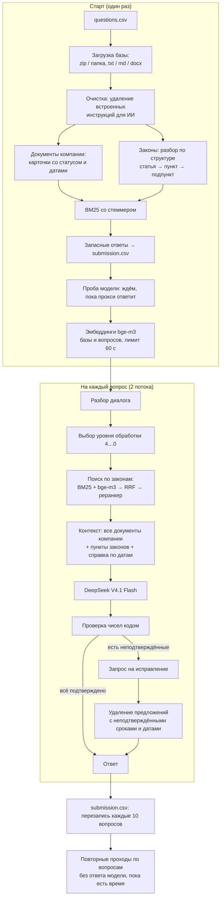

# 03. Архитектура (исходно — v1.3)

Документ описывает конвейер v1.3. Он остаётся основой текущей версии; что изменилось после — в разделе ниже, актуальная карта модулей — в [README](../README.md#как-устроено-ядро). Зависимости: стандартная библиотека Python и `httpx`.

## Что изменилось после v1.3 (на 12.11.2026)

| Изменение | Где | Флаг (по умолчанию) |
|---|---|---|
| Код разложен на плоские модули в корне (`config`, `textproc`, `dates`, `kb`, `runtime`, `llm`, `index`, `prompts`, `checks`, `pipeline`, `probe`, `solution`) без изменения поведения | все модули | — |
| Фасад для веба `assistant.LegalAssistant`: тот же конвейер, `Result` с цитатами, статусом и полем `context` | `assistant.py`, `pipeline.py` | — |
| Блоки `PLATFORM PROBE` / `RUN STATS` в stderr | `probe.py` | `SOLUTION_PROBE` (вкл) |
| Готовый индекс эмбеддингов `index_vectors.json` вместо расчёта на старте | `index.py` | `SOLUTION_PREBUILT_INDEX` (вкл) |
| Разовый 4xx не понижает уровень на весь прогон (B5); реранкер отключается временно (B6); уровень по прогнозу времени (B7); финальный проход на полном уровне (B8) | `pipeline.py`, `llm.py`, `runtime.py`, `solution.py` | вкл |
| Ответ строго на вопрос, 20–60 слов (B9) | `prompts.py` | `SOLUTION_CONCISE` (вкл) |
| Переформулирование запроса для диалогов и слабого поиска; поиск по нескольким запросам (R7) | `pipeline.py`, `index.py`, `prompts.py` | `SOLUTION_REWRITE` (вкл) |
| Few-shot на вымышленных документах (7.6), номера документов не числа (B3), проверка ссылок (7.1) | `prompts.py`, `checks.py` | выкл — ждут golden set |
| Общие пункты больших статей вне урезанного бюджета (B12), справка по датам с условиями (R4), отсылки внутри законов (R6) | `pipeline.py`, `dates.py`, `kb.py` | выкл |

Ниже — описание v1.3. Отличия от текущей версии: модули вместо одного файла; эмбеддинги базы берутся из готового индекса, а не считаются на старте; уровень обработки выбирается по прогнозу времени; формат ответа — B9; перед поиском для диалогов и слабого поиска может быть вызов переформулирования.

## Конвейер



## Этапы

### 1. Загрузка базы
- **Поиск файлов.** Ищет `questions.csv` и базу в `DATA_DIR`, в `DATA_DIR` относительно скрипта, в `./data` и в текущей папке. База — архив `knowledge-base.zip`, `knowledge_base.zip` или `kb.zip`, папка с одним из этих имён или единственный `*.zip` в папке.
- **Чтение.** Читает `.txt`, `.md` и `.docx`. Кодировка — UTF-8, при ошибке cp1251. Пропускает `__MACOSX`, скрытые и двоичные файлы.
- **Тип документа.** По пути и тексту отличает документы компании от законов.
- **Очистка от инъекций.** Удаляет строки, которые адресованы ИИ и требуют что-то сделать: «игнорируй», «отвечай», «инструкция» рядом с «ИИ», «ассистент», «LLM». Вместо строки вставляется пометка «[Фрагмент удалён…]». В базе такая вставка одна — в служебной записке ЮО-7 («отвечай 90 дней»).

### 2. Разметка документов
- **Карточки документов компании.** Заголовок, даты действия и статус: «УТРАТИЛ СИЛУ с 01.03.2025; действовал с 10.01.2023 по 28.02.2025» или «действующая редакция, действует с 01.03.2025». Модель видит статус в заголовке каждого документа.
- **Законы режутся по структуре:** статья → пункт или часть → подпункт, фрагмент до 1600 символов.
  - Пометки Гаранта вида «Пункт 3 изменен с 1 января 2026 г.» сохраняются при своём пункте как «[Пометка редакции: …]».
  - Заголовки без текста приклеиваются к следующему пункту.
  - Длинные пункты делятся по абзацам с пометкой «(продолжение)».
- **Тема статьи НК — в поисковый текст.** Ст. 164 и 284 не содержат слов «НДС» и «налог на прибыль», поэтому к поисковому тексту добавляется тема главы: 164 → НДС, 224 → НДФЛ, 284 → налог на прибыль. Модель эту добавку не видит.

### 3. Индекс и поиск
- **BM25** (k1 = 1,5, b = 0,75) по основам слов.
  - Стеммер Snowball для русского языка написан в файле, без внешних библиотек; совпадает с эталонной реализацией на 4153 словах.
  - Перед поиском запрос расширяется словарём синонимов: «главбух» → «главный бухгалтер», «НДС» → «налог на добавленную стоимость налоговая ставка» и т. п.
- **Плотный поиск bge-m3** через прокси.
  - Фрагменты векторизуются пачками по 16 в 4 потока, на всю базу — не больше 60 с, на вопросы — не больше 25 с.
  - Не уложились или ошибка — работаем только на BM25.
- **Объединение RRF** (k = 60) по первым 80 результатам каждого списка.
- **Реранкер Qwen3.**
  - Переупорядочивает 30–40 кандидатов среди законов, по 1200 символов на кандидата.
  - Работает только на уровне 4.
  - Тайм-аут 12 с. Отключается до конца прогона при тайм-ауте, после 3 ошибок подряд, после 2 постоянных ошибок или если в среднем отвечает дольше 6 с.

### 4. Контекст для модели
- **Все 8 документов компании целиком** (~5 тыс. токенов), если их суммарный объём не больше 45 000 символов.
  - Так нет промахов поиска, и модель видит связи между документами: договор и допсоглашение, две редакции регламента, письмо К-12 и п. 5.4 регламента.
  - В компактных режимах берутся только найденные документы вместе со связанными.
- **Законы — в пределах бюджета:** 12 000 символов на уровне 4, 8 000 на уровне 3, 4 000 на уровне 2, 2 000 на уровне 1.
  - Короткие статьи (≤ 7 000 символов) из первых четырёх результатов идут целиком.
  - Из длинных статей берутся найденные пункты.
  - К длинным статьям из первых трёх результатов добавляются короткие пункты верхнего уровня (≤ 700 символов, всего ≤ 2 500). Там обычно общие правила — например, общая ставка НДС в п. 3 ст. 164, — которые плохо находятся по словам вопроса.
- **Меньше законов для вопросов о договорах.** Если по BM25 вопрос явно о документах компании, бюджет законов урезается до 5 000 символов: меньше шума.
- **Справка по датам.** Код находит в вопросе даты и периоды («в августе 2024 года») и пишет, какие документы компании действовали в этот период, а какие нет. Модели не нужно сравнивать даты самой.

Средний запрос — около 25 тыс. символов (от 21 до 31 тыс.) плюс системный промпт около 7 тыс. символов.

### 5. Промпт
- **Системный промпт** — 12 правил: только документы базы, отказ при отсутствии данных, частичный ответ, ссылки на пункты, проверка предпосылок, редакции на дату, неоднозначность, защита от инъекций, устойчивость к давлению, отказ помогать нарушениям, вопросы не по теме, расчёты с формулой. Дальше — требования к формату и 8 примеров в стиле `demo_output`.
- **Сообщение пользователя** — блоки в фиксированном порядке: текущая дата → документы компании (полные тексты со статусом) → законы (действующая редакция, пометки) → справка по датам → история диалога → вопрос.
- **Диалог.** Реплики «Пользователь:» и «Ассистент:» разбираются отдельно. Отвечаем на последнюю реплику пользователя, а утверждения ассистента из истории велено перепроверять.

### 6. Генерация
- **Параметры вызова.** `temperature` и `max_tokens` берутся из окружения платформы, как в стартовом примере.
- **Ответ не поместился в лимит:**
  - текст пустой — один повтор с удвоенным лимитом;
  - текст есть — обрезается до последнего законченного предложения.
- **Очистка ответа.** Удаляются `<think>`-блоки, markdown, префикс «Ответ:». Ответ ограничен 3 000 символами.

### 7. Проверка чисел (защита от выдуманных фактов)
`unverified()` извлекает из ответа числа с единицами измерения:
- рабочие, календарные и просто дни;
- месяцы, недели, годы, часы;
- число месяца, рубли, проценты, «раз»;
- а также даты и годы.

Каждое из них должно найтись в контексте или вопросе с совместимой единицей либо получаться простым расчётом:
- умножение, проценты и деление — из чисел документов;
- сложение и вычитание — только с участием числа из вопроса.

Дальше по найденным нарушениям:
1. Если что-то не подтвердилось, а время есть (уровень 4), модель получает черновик и список неподтверждённых чисел с просьбой исправить.
2. Если неподтверждёнными остались **сроки или даты**, предложения с ними удаляются. Ответ не удаляется целиком: если осталось меньше 8 слов, он сохраняется как есть.

На 18 эталонах `demo_output` ложных срабатываний 0. На подложенных ошибках (7 рабочих дней вместо 5, «90 дней», выдуманная редакция) проверка срабатывает.

### 8. Запись результата
- **Сразу после загрузки базы** пишется полный `submission.csv` с запасными ответами. Запасной ответ — лучший фрагмент BM25 (до 450 символов): «По данным базы знаний (…): …».
- **По ходу работы** файл перезаписывается каждые 10 вопросов, атомарно через временный файл.
- **Формат:** UTF-8 без BOM, все поля в кавычках, порядок и `id` как во входном файле.

## Уровни обработки

Уровень выбирается перед каждым вопросом. Решение сравнивает, сколько секунд осталось на каждый оставшийся вопрос, со скользящим средним длительности вызовов.

| Уровень | Что делает | Когда |
|---|---|---|
| 4 | Реранкер, полный контекст (законы 12 000), исправление чисел | Времени ≥ 1,6 × (вызов + реранкер) |
| 3 | Полный контекст без реранкера (законы 8 000) | Времени ≥ 1,2 × вызов |
| 2 | Компактный: найденные документы компании (≤ 10 000), законы 4 000, 4 примера | Времени мало, или прокси отклонил полный запрос |
| 1 | Минимальный: 2 документа компании (≤ 5 000), законы 2 000, 2 примера | Времени совсем мало, или прокси отклонил компактный запрос |
| tiny | Запрос размером со стартовый пример: короткий промпт + 6 фрагментов (≤ 2 800 символов) | Прокси отклонил минимальный запрос |
| 0 | Запасной ответ без модели | До дедлайна меньше 15 с |

**Отказ прокси с кодом 4xx** понижает режим для всех последующих вопросов. Если прокси отклоняет полный запрос, нет смысла посылать его снова на каждом вопросе.

## Надёжность: сбой → реакция

Все сценарии проверены на заглушке прокси (см. [тестирование](06_testing.md)).

| Сбой | Реакция |
|---|---|
| Прокси или модель ещё не готовы при старте | Пробный вызов с паузами 2 → 20 с, пока до дедлайна не останется 150 с. Эмбеддинги строятся только после ответа модели |
| Модель перестала отвечать посреди прогона | После 6 неудач подряд один поток раз в 20 с проверяет модель, остальные ждут. Вопрос не бросается до 30 с до дедлайна |
| Вопрос остался с запасным ответом | Повторные проходы по таким вопросам до дедлайна, максимум 20, с паузой 20 с, если проход ничего не дал |
| 429 (ограничение частоты) | Общая пауза для всех потоков (`retry-after` или 1–2 с). Лимит одновременных запросов уменьшается на 1 и растёт обратно после 10 успехов. Попытки 429 не тратит |
| 5xx, сетевые ошибки, 408, 409, 425 | До 4 попыток генерации с экспоненциальной паузой |
| 4xx (размер, параметры) | Режим понижается: полный → компактный → минимальный → tiny |
| Эмбеддинги медленные или недоступны | Не больше 60 с на базу, иначе только BM25 |
| Реранкер медленный или с ошибками | Отключается до конца прогона (см. выше) |
| Неожиданный формат ответа | Ошибка считается временной: вопрос получит запасной ответ и повторится в следующем проходе |
| База не загрузилась | Корректный файл с ответом «в базе знаний не найдено документов» |
| Нет переменных доступа к API | Остаются запасные ответы |

**Транспорт — как в стартовом примере организаторов:** новый `httpx.Client` на каждый запрос, тайм-аут генерации 90 с. Общий бюджет времени — 16,5 мин (`SOLUTION_TIME_BUDGET`, по умолчанию 990 с) при лимите платформы 20 мин.

## Переменные окружения

| Переменная | По умолчанию | Назначение |
|---|---|---|
| `DATA_DIR` | `data` | Где искать `questions.csv` и базу |
| `LLM_BASE_URL` / `BASE_URL` / `OPENAI_BASE_URL` | — | Адрес прокси (первая заданная) |
| `LLM_API_KEY` / `OPENAI_API_KEY` | — | Ключ |
| `EMBEDDER_API_KEY`, `RERANKER_API_KEY` | ключ LLM | Отдельные ключи, если заданы |
| `LLM_MODEL` / `GEN_MODEL` / `OPENAI_MODEL` | `deepseek/deepseek-v4.1-flash` | Модель генерации |
| `EMB_MODEL` | `baai/bge-m3` | Модель эмбеддингов |
| `RERANKER_MODEL` | `cohere/rerank-5-fast` (как в стартере; платформа передаёт свою) | Реранкер |
| `MAX_TOKENS` | 1024 | Лимит токенов ответа |
| `MAX_WORKERS` | 2 | Потоков генерации и начальный лимит одновременных запросов |
| `TEMPERATURE` | 0 | Температура |
| `TOP_K` | — | Число кандидатов для реранкера: `TOP_K`, ограниченный диапазоном 30–40 |
| `RERANKER_TOP_N` | — | Фрагментов законов в контексте: `RERANKER_TOP_N`, ограниченный диапазоном 8–14 |
| `SOLUTION_TIME_BUDGET` | 990 | Бюджет времени, с |
| `SOLUTION_DEBUG` | — | `1` — писать `debug.jsonl`: контекст, черновик, неподтверждённые числа, итог по каждому вопросу |

## Карта кода

Строки — в однофайловой v1.3 (`tools/baseline/solution_v1_3.py`). В текущей версии каждый раздел — отдельный модуль: настройки → `config.py`, стеммер → `textproc.py`, загрузка базы → `kb.py`, HTTP-клиент → `llm.py` и `runtime.py`, индекс → `index.py`, разбор вопроса → `dates.py` и `pipeline.py`, промпт → `prompts.py`, проверка чисел → `checks.py`, ответ → `pipeline.py`, ввод-вывод и `main` → `solution.py` и `probe.py`.

| Строки | Раздел | Главное |
|---|---|---|
| 1–105 | Настройки | Переменные окружения, константы бюджета, `debug_dump` |
| 107–258 | Стеммер | `RussianStemmer` (Snowball), `tokenize`, стоп-слова |
| 261–816 | Загрузка базы | `find_kb`, `iter_kb_files`, `sanitize` (инъекции), `company_meta` (статусы), `parse_law` (структура законов), `NK_CHAPTERS`, `build_kb` |
| 818–1103 | HTTP-клиент | `post_json` (повторы, 429, `Gate`), `chat` / `_chat`, `Flags`, `Timing`, `embed`, `rerank` |
| 1106–1217 | Индекс | `SYNONYMS`, `Index.bm25`, `build_dense`, `hybrid` (RRF) |
| 1220–1321 | Разбор вопроса | `parse_dialog`, `event_periods`, `date_note` |
| 1324–1421 | Промпт | `SYSTEM_PROMPT`, `FEW_SHOT`, `build_user_message` |
| 1424–1637 | Проверка чисел | `extract_numbers`, `unverified`, `_derivable`, `drop_sentences` |
| 1640–1949 | Ответ | `fallback_answer`, `select_law`, `company_context`, `choose_level`, `answer_tiny`, `answer_one` |
| 1952–2134 | Ввод-вывод и `main` | `load_questions`, `write_submission`, `wait_for_llm`, `embed_questions`, `main` |

## Как читать лог (stderr)

Реальный лог прогона на заглушке. Прокси здесь поднимается только через 60 с после старта:

```
[    0.0s] Вопросов: 18
[    0.0s] База знаний: knowledge-base.zip, документов: 21
[    0.0s] Удалены встроенные инструкции (1) в документе: Служебная записка об архиве договоров
[    0.1s] Документов компании: 8, законов: 13, фрагментов: 336
[    0.1s] Записан предварительный submission.csv с запасными ответами
[    8.4s] Проба модели 1: нет ответа (ConnectError /chat/completions), ждём 2 c
...
[   62.4s] Модель отвечает (проба 5, 0.0 c)
[   62.5s] Эмбеддинги базы готовы: 336 фрагментов за 0.1 c
[   62.5s] Реранкер работает, поля ответа: ['results'], 0.0 c
[   62.7s] Неподтверждённые числа ['7'] — запрашиваю исправление
[   63.0s] Обработано 18/18; уровень сейчас 4, chat≈0.0/0.0 c
[   63.0s] Готово: {'llm_ok': 18, 'fallback': 0, 'repaired': 4, 'trimmed': 0, 'rerank_ok': 18,
           'level4': 18, ...}, tiny=False, ..., dense=True, compact=False, minimal=False, rerank_off=False
```

В итоговой строке:
- `llm_ok` — ответов модели;
- `fallback` — запасных ответов;
- `levelN` — сколько вопросов обработано на каждом уровне;
- `repaired` — сколько ответов исправлено после проверки чисел;
- `trimmed` — у скольких удалены предложения;
- `dense`, `rerank_off` — работали ли эмбеддинги и реранкер;
- `compact`, `minimal`, `tiny` — включалось ли понижение режима.

**На платформе этот лог нам не виден.**

## Известные ограничения

- **Реальных ответов DeepSeek V4.1 Flash на платформе мы не видели.** Качество ответов — главная неизвестная (см. [план](05_roadmap.md)).
- **Законы — только в действующей редакции.** На вопрос о прошлой редакции закона решение может только сказать, что её в базе нет.
- **Проверяются только числа.** Номера пунктов и статей и цитаты пока не сверяются с текстом (см. эксперимент X2).
- **Синонимы и темы глав НК заданы вручную под эту базу.** Для другой базы их нужно пересмотреть.
- **Документы компании целиком — только для маленьких баз.** Это работает, пока документов меньше 45 000 символов. Для большой базы решение перейдёт на поиск по документам компании (код для этого есть, но на реальной модели не проверялся).
